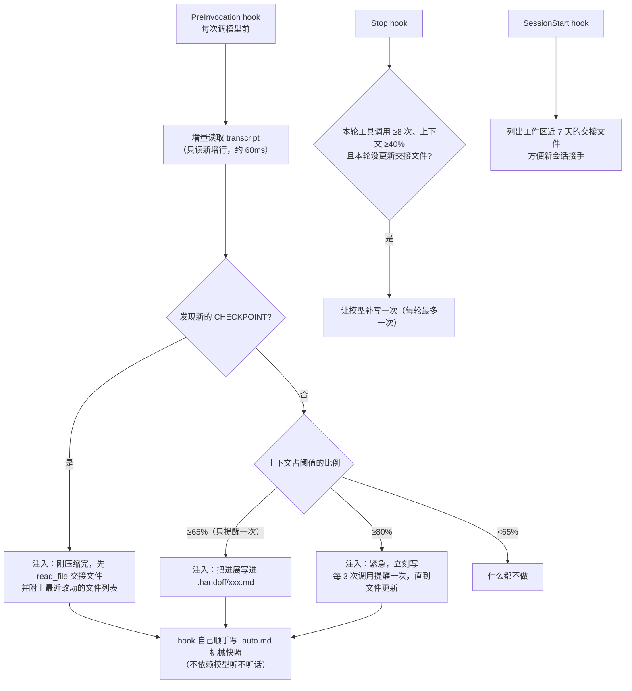

# context-handoff：Antigravity 自动压缩交接方案

## 问题

对话上下文太长时，Antigravity 会自动压缩：把历史换成一段摘要（transcript 里会出现 `CHECKPOINT` 步骤，内容以 `# Resuming from a compaction` 开头）。摘要会丢掉文件路径、已经排除的方案、做到一半的步骤等细节。Antigravity **没有 PreCompact hook**，所以没法在压缩那一刻插一脚。

## 思路：预测 + 交接 + 回读

能拿到的信号：

1. **每个 hook 的 stdin 都带 `transcriptPath`**，这个 transcript 是实时写入的。
2. 每个 `PLANNER_RESPONSE` 记录了 `input_tokens + cache_read_tokens`，也就是这一次调用的真实上下文大小。
3. 本机 57 个历史会话里，31 次压缩都发生在 **约 25.4 万–28 万 tokens**（或距上次压缩 52 万–82 万字节的 transcript）时，规律很稳定。



### 双层保险

| 层 | 谁写 | 内容 | 可靠性 |
| --- | --- | --- | --- |
| `.handoff/<时间>_<会话id前8位>.md` | 模型（被 hook 提醒） | 目标、当前状态、下一步、关键决策、坑、关键路径 | 质量高，但依赖模型照做 |
| `.handoff/<同名>.auto.md` | hook 脚本 | 全部用户请求、改过的文件、最近命令、**涉及仓库的 `git status` / `git diff --stat`**、最近回复摘录（敏感信息已打码） | 100% 会生成，但比较粗 |

### 历史版本（追加，不覆盖）

`.handoff/history/` 下：

- `<stem>.vNN_HHMMSS.md`：模型每写出一个新版本的交接文件，就存一份副本（每个会话保留最近 20 份）。即使某次重写质量很差，或者摘要越写越粗，旧版的细节也还在。
- `<stem>.cN.md` / `<stem>.cN.auto.md`：第 N 次压缩时冻结的交接文件和快照。

### Git

- 快照会对“改过的文件所在的仓库 + 工作区仓库”（最多 3 个）执行 `git status --short --branch` 和 `git diff --stat HEAD`，结果缓存 60 秒；压缩时和紧急提醒时强制刷新。
- 交接目录位于 git 仓库内时，自动把它写进 `.git/info/exclude`。这个文件只在本地生效、不会被提交，所以不会污染 `git status`，也不用改 `.gitignore`。不需要的话，在 `config.json` 里设 `git_exclude: false`。

### 阈值自校准

- `calibrate` 扫描历史 transcript，记下每次压缩前的 tokens 和字节数，取最近 10 次的**最小值**作为压缩点。
- 之后每检测到一次新的压缩，就把这次的数值追加进去，同时按 `modelName` 分开统计。
- 没有 token 字段时（旧版 transcript），退回用字节数估算。
- 想手动固定阈值，可以在 `config.json` 里设 `compaction_tokens` 或 `compaction_bytes`。

## 文件

| 文件 | 作用 |
| --- | --- |
| [hooks.json](hooks.json) | 注册 SessionStart / PreInvocation / Stop 三个 hook |
| [hooks/handoff.py](hooks/handoff.py) | 全部逻辑。出错时一律放行（输出 `{}`），错误写进 `.state/error.log` |
| [rules/AGENTS.md](rules/AGENTS.md) | 始终加载的简短协议和交接模板（压缩后规则会重新注入，不会丢） |
| [skills/handoff/SKILL.md](skills/handoff/SKILL.md) | 手动“写交接 / 从交接继续”的流程 |
| [config.json](config.json) | 阈值和开关 |
| [install.ps1](install.ps1) | 用 junction 链接到 `~/.gemini/config/plugins/` 并做校准 |

## 安装 / 卸载

需要 Windows + Python 3.9+（在 PATH 中）+ Antigravity。

```powershell
git clone https://github.com/Ly1922/context-handoff.git
cd context-handoff; .\install.ps1
# 卸载：删除 junction（源码不受影响）
(Get-Item "$env:USERPROFILE\.gemini\config\plugins\context-handoff").Delete()
```

macOS / Linux：把仓库链接到 `~/.gemini/config/plugins/context-handoff`，然后运行 `python3 hooks/handoff.py calibrate`。如果系统里只有 `python3` 命令，需要把 `hooks.json` 里的 `python` 改成 `python3`。

调试：`python hooks/handoff.py status <conversationId>`

## 已知限制

- 阈值是估算的。一次读进一个特别大的文件，可能直接越过 80% 线就触发压缩，所以还有 `.auto.md` 和压缩后回读兜底。
- 模型写交接文件要花一次工具调用（约几千 tokens），每次压缩周期一般只发生 1–2 次。
- 依赖 transcript 格式（`CHECKPOINT`、`input_tokens` 字段）。如果 Antigravity 改了格式，hook 会安静地失效，不会报错。
